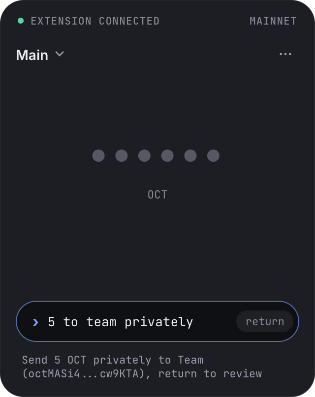
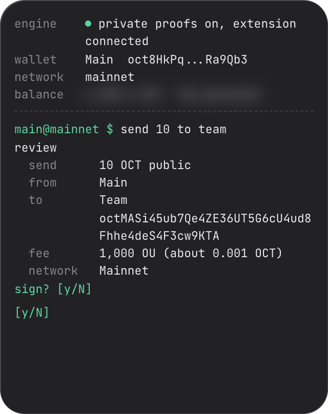

The **0xio Desktop** is a native desktop application built with [Tauri](https://tauri.app/) (Rust backend and React frontend). It is a full wallet for the Octra Network, a menu bar panel for everyday sends and private operations, and a **native privacy engine** that builds proofs for the browser extension.

<Note>
  **Status: Live (v0.6.0).** Download it from [0xio.xyz/install](https://0xio.xyz/install) for macOS (Apple Silicon, signed and notarized by Apple) or Windows.
</Note>

## Why Desktop?

Browser extensions run in a sandbox with limited access to the CPU and memory, and private proofs are heavy work. The desktop app runs **pvac-rs** natively with every CPU core, so private operations finish faster than in the browser, both in the app and for the extension when the two run together.

---

## Menu Bar Panel

Click the 0xio icon in the menu bar for your wallet at a glance. The panel opens over other apps, including full-screen ones, on every Space and on the display you clicked.

- **Balance** up front, hidden until you click it, with a live status line for the privacy engine.
- **Send**, **Receive** (with a QR code), **Private** and **Lock**, and a wallet switcher. The **•••** menu holds the network, Lock now, Open at login, Open and Quit.
- **Private:** encrypt or decrypt, claim private transfers, turn on a private balance, migrate it or update the encryption key, each with the live network fee.
- **Locked:** unlock in the panel with Touch ID or your password.
- The menu bar icon shows an outline while locked, a turning slash while a private proof runs, and the number of site requests waiting (else the transfers waiting to be claimed).

### Command Line

The panel has a command line that reads loose input, for example `send 10 to 0xio privately`, `pay bob half` or `5 to oct8Hk...`. It accepts any word order and small typos, amounts such as max, half, 25% or 1.5k, and recipients by contact name, wallet name or address prefix. A live line says what Return will do. A command only fills the form: every send still opens its review.

<Frame caption="The menu bar panel with a command typed">
  
</Frame>

### Themes

Choose the panel's look in **Settings > Appearance > Menu bar theme**: Match app, Original, Smoke, Frost, Octra, Clear, Phosphor, Ember or CLI.

The **CLI** theme turns the panel into a terminal with no buttons. Type `0xio --help` for the commands (send, receive, qr, encrypt, decrypt, private, claim, migrate, lock, unlock, balance, status, wallets, use, network, theme, open, quit and more). It keeps history and tab completion, shows a review before anything is signed, and signs only after you type `y`. A review lapses when the wallet, network, lock state or fee changes before you answer.

<Frame caption="The CLI theme with a send review">
  
</Frame>

### Reviews and Fees

- Every send, encrypt, decrypt, setup, migration and key update shows a review with the wallet, network and live network fee, then asks for Touch ID or your password.
- The fee on the review is the fee signed, as long as the network still accepts it. You are asked to review again only when the network's minimum fee rises above it.
- A fee that cannot be read blocks the action with **Network fee unavailable. Try again.** No default fee is ever signed.
- An approved request runs only on the wallet and network its review showed.
- A busy node gets the same signed transaction again (3 tries in all). A nonce that is already used sends the transaction back to review; nothing is re-signed on its own. A rejected or too large transaction says so. See [What Happens After You Send](/wallet/sending#what-happens-after-you-send).
- A private send is offered only when the private balance is ready. A balance that is due for a migration, needs a key update or setup, or is waiting for the network shows its status, with **Migrate**, **Update** or **Turn on** where the app can do it.

### Sites Through the Extension

A website can sign with the desktop wallet instead of the browser. In the extension's connect review, pick **Sign with: 0xio Desktop** and press **Continue**. The extension only carries the site's requests over the paired connection; every one is reviewed in the menu bar and signed by the desktop app.

- **Arrival:** when nothing is waiting and the panel is closed, the first request opens the panel on its review. Later requests never take focus; they raise the count on the menu bar icon.
- **Notifications:** while the panel is closed, a later request also shows one macOS notification for its site, for example "https://app.octradex.xyz wants you to sign a transaction". A site gets one at a time. Click it to open the panel on that request, or on the Requests list when more wait. macOS asks for permission the first time one is due. Turn them off in **Settings > Security & Privacy**, **Notify me about site requests**; if macOS has them off, the row says so with **Open settings**.
- **Requests:** two or more waiting show the Requests list, grouped by site with its browser and **Reject all** per site. Repeat connect requests from one site merge into one row (for example 2 tabs). A review has a way back to the list; answering lands on the list, or closes the panel when nothing is left. A click outside closes the panel without answering.
- **Every review:** Reject and the verb (Connect, Send, Sign, Switch, Claim, Deploy), the full site address with its scheme, the page around it when the site is in a frame, **Via 0xio extension (Chrome)** or **(Firefox)**, the wallet, and the live network fee for anything that pays one. Touch ID or your password follows for anything that signs.
- **Everything signed is shown:** a contract call shows its exact arguments, a deploy its constructor params, and any memo in full. A contract sequence lists each step (contract, method, exact arguments and amount) with the OCT total. A connect review lists every permission the site gets, private ones included.
- **Refused before review:** a sign-only request for anything but a standard transfer, a message or memo over 4,000 characters (never cut short) and contract params that are not an array.
- **Locked:** the panel asks you to unlock first, then shows the review.
- **Networks:** each site keeps its own network. A site's network switch is its own review and moves only that site.
- **Limits:** at most 3 requests per site wait at once and a site is rate limited; a request beyond that gets an error at once. After you reject a review, that site's next requests are refused for 5 seconds without a review. A tab that closes or reloads takes its requests with it.

Sites connected this way are listed in **Settings > Security & Privacy**, **Connected sites**, per network (Mainnet or Devnet), each with the browser it came through and the wallet it uses. **Disconnect** asks once more in place. Removing the extension in **Paired apps** first says how many sites it forgets and lists them in the panel.

### Sites Straight from the Browser

A website can also reach the desktop wallet with no extension at all. When the site offers **0xio Desktop** and you press Connect, it opens a connection to the app on this computer; the browser names the site and the site cannot pretend to be another one.

- **Same reviews:** every connect, sign, send and network switch opens in the menu bar exactly like a site through the extension, with **Reject** and the verb, the live fee, then Touch ID or your password. The review shows **Connection: Direct from browser** where a relayed site shows the extension. A locked wallet asks you to unlock first.
- **What a site learns:** nothing about you until you approve its connect. After that it sees the wallet it uses, as with the extension.
- **Chrome asks first:** the first time a website reaches the app, Chrome (and Edge) shows a prompt that the site wants to access apps and services on this device (**Apps on device**). Allow it for sites you use; Block stops that site from reaching the app. You can change it later in the site's settings in Chrome.
- **Limits:** the same as through the extension (3 waiting requests per site, a rate limit), and a cap on how many pages can be connected at once. Closing a tab ends its waiting requests; the site stays connected and picks up again when you come back.
- **Turn it off:** **Settings > Security & Privacy**, **Websites can connect without the extension** (on by default). Off refuses websites at once and closes the open ones; sites through the extension keep working.

These sites are listed under **Connected sites** with **Direct from browser** and **Disconnect**.

### Lives in the Menu Bar

Closing the window (the red button, Cmd+W or Cmd+Q) keeps 0xio Desktop running in the menu bar without a Dock icon. The wallet, auto-lock and proof work carry on. Open the window again from the menu bar, Finder, Spotlight or the Dock. **Quit** in the menu bar menu or panel quits the app. **Open at login** starts it quietly in the menu bar.

---

## Core Wallet Features

### Dashboard & Balances

The home screen displays your public and private (FHE-encrypted) balances, recent transactions, and token holdings, the same as the extension and mobile app.

### Sending & Receiving

- **Send screen**: the form on the left and a live panel on the right. Pick a recipient from the address book, your wallets or recent sends (each shows when you last sent), enter the amount with Max and the token, and add a message on public OCT. The panel shows both balances, the live network fee, who the recipient is to you (saved in, sent before, last send) and what is left after the send
- **Review in place**: Review send locks the form and turns the panel into the review card (amount, from, to, network fee, total, balance after, message) with **Reject** and **Send**. Reject returns to editing with every value kept; Send reads the fee again, asks for Touch ID or your password, then shows Signing and Broadcasting, and Sent with the hash, View in History and New send
- **Standard transfers**: Public on-chain transactions with memo support
- **Private transfers**: FHE-encrypted stealth transfers (recipient must have a registered PVAC public key). The proofs run in the shared proof queue with five steps and the elapsed time of each; a private send pays its fee from the public balance, so the total shows a private line and a public line
- **Bulk send**: rows in the same frame (add one, paste a list or import a CSV), totals in the panel, then one review listing every send in order and the progress in the same card. Duplicate addresses and a total over the balance are flagged. Private (FHE) bulk sends are available only in the desktop app and run as one job in the proof queue
- **QR codes**: Generate and share receive addresses
- **Exact token amounts**: token amounts in Send, bulk send and their reviews are exact whole units, never rounded
- **OU control**: press the network fee to pick Slow, Normal, Fast or a custom fee. Every preset comes from the node's live quote, and Fast shows only when the node quotes it. Private operations have floors (5,000 ou, claims 3,000 ou); see [Network Fees](/wallet/sending#network-fees)
- **Private send readiness**: a private send is offered only when the private balance is ready; otherwise the panel shows what comes first (turn on, refresh the key, migrate, a key update on hold) with its own review

### Privacy Operations

Full encrypt, decrypt and claim support, same as the extension. The Privacy screen has a composer on the left with **Encrypt**, **Decrypt** and **Claim** tabs and a live **Proofs** panel on the right. Each operation is reviewed in the composer's place with **Reject** and the verb, then Touch ID or your password; the job then joins the proof queue and the composer is free for the next one.

- **Proof queue**: one job at a time, in the order confirmed, so nonces and the balance's layers stay in order. The running job shows its step dots (encrypt has four steps; decrypt, claim and private send five) with the elapsed time of each step, then Up next and what finished today. A failed proof stays on top with its error, **Remove** and **Retry**, and the jobs behind it wait as Paused
- **Claim**: waiting transfers oldest first, each with its own Claim. Any of them can be claimed, one per press, because each claim adds two layers; the review shows the sender, the live fee, the private balance and the layers after
- **Turn on private balance**, **Refresh key** (at four or more of eight layers), **Migrate balance** and a **key update on hold** each show in the composer with the wallet, network and live fee. A changed fee, wallet or network is refused before any proof work
- **Proof rules**: private operations follow the proof rules the network states, read again before each submit. A network that does not state them gets no private operation, and a change in between sends nothing. See [Network Proof Rules](/wallet/privacy-operations#network-proof-rules)

<Steps>
  <Step title="Encrypt (Public → Private)">
    Shield funds using FHE. Your device generates a Pedersen commitment and zero-knowledge bound proof locally.
  </Step>
  <Step title="Decrypt (Private → Public)">
    Unshield funds back to your public balance.
  </Step>
  <Step title="Claim">
    Scan the blockchain for incoming private transfers and decrypt them into your wallet.
  </Step>
</Steps>

### Multi-Wallet Support

Create or import multiple wallets using 12/24-word seed phrases. All wallets use the same master root key derivation (`HMAC-SHA512("Octra seed", seed)[0:32]`) as the extension and mobile app, so importing the same seed phrase produces the same address across all 0xio platforms.

---

## NFTs & Marketplace

### NFT Gallery

- Every collection the wallet holds shows without an import step, including collections on the 0xio NFT list that the node does not list. **Import** stays for any other contract.
- The newest piece leads, then one shelf per collection, newest first.
- Hide a collection or a single piece, with Undo for four seconds. Hidden ones wait on the **Hidden** shelf, kept per network and wallet.
- A piece opens as a page with its status, who holds it and two actions.

### Living NFTs

Living NFTs are on-chain programs that draw their own art. The detail view runs the program in an isolated frame with no access to the wallet. A program that reads the chain may reach only its own network's RPC; gallery thumbnails stay offline. See [NFT Standards](/wallet/nft-standards#living-nfts-euint-labs-geodesics-and-chain-state-collections).

### Xpectrum Marketplace

List and manage your NFTs on the Xpectrum marketplace from the wallet:

- **List for sale**: two-signature listing flow with on-chain verification
- **Change price**: cancels, approves again when needed and lists again, with every signature shown on the review first
- **Cancel listing**: delist an NFT at any time

---

## Companion Mode: Accelerating the Extension

The desktop app runs a **local WebSocket server** on `ws://127.0.0.1:19345` that the browser extension connects to automatically when both are running.

### How It Works

1. The extension detects the desktop app on the local machine, and both prove the pairing secret to each other (see Pairing with the Extension)
2. Only then the extension sends the PVAC master seed, a one-way hash of the wallet key, and the desktop derives the same PVAC keys from it. The key that signs transactions never leaves the extension
3. For heavy FHE operations, the extension delegates computation to the desktop app
4. Desktop computes using native Rust with all CPU cores, returns the result
5. Extension uses the result as if it computed locally

### What Gets Accelerated

Range proofs, bound proofs, commitments and PVAC key work for the extension's encrypt, decrypt, private send and claim all run natively in the desktop app.

### Security

- **Loopback only**: The WebSocket server binds to `127.0.0.1`, so no remote connections are accepted
- **Paired clients only**: The extension and local programs pair once, and the extension proves its pairing on every connection before any key material moves. A website that connects straight from the browser can only send site requests for its own address, each reviewed in the menu bar; it never reaches proofs, keys or pairing
- **Connection limit**: Maximum 8 concurrent connections
- **Message size cap**: 16 MiB per message for the extension and paired programs (range proofs can be 1 to 3MB), 1 MiB for web pages
- **Handshake timeout**: a connection that does not finish its handshake within 5 seconds is closed, and only finished handshakes count toward the connection limit
- **Idle timeout**: 300 seconds
- **No signing key**: The desktop can build proofs and read the private balance, but it cannot sign, because it never receives the wallet key (extension 2.5.6 and later)
- **Memory safety**: The master seed is zeroized after use on both sides

### Status Indicators

- **Extension**: the extension's status bar shows a **0xio Desktop** chip while the desktop app runs its proofs
- **Menu bar icon**: the slash turns while a private proof runs
- **Engine card**: the menu bar names the extension only for the extension's own proofs

---

## AI Contract Assistant

The desktop app includes an AI-powered assistant for smart contract development:

- **AML brainstorming**: describe what you want your contract to do and get AML code suggestions
- **Code generation**: generate complete contract templates from natural language descriptions
- **Error fixing**: paste compiler errors and get suggested fixes

---

## Contract Developer Tools

The desktop app includes a full smart contract development suite: compile, deploy, verify, and interact with contracts directly.

### Write & Compile

Write contracts in two languages:

| Language | Extension | Description |
|----------|-----------|-------------|
| **AppliedML** | `.aml` | High-level language with automatic ABI generation. Recommended for most developers. |
| **Assembly** | `.oasm` | Low-level bytecodes for advanced users. |

- **File import**: Load `.aml` or `.oasm` source files
- **Compile**: Sends source to the network compiler, returns bytecode + ABI
- **Error reporting**: Line numbers and error messages from the compiler

### Deploy

- **Address preview**: Predict your contract's address before deploying (based on sender + nonce)
- **Constructor parameters**: JSON array input for initialization values
- **Deploy fee**: set by the size of the code, the way the Octra reference client sets it: 200,000 OU plus 1,000 OU per started KiB. A site may set its own deploy fee up to 10,000,000 OU
- **Source verification**: Verify deployed bytecode matches your source on-chain

### Interact

- **ABI-driven forms**: Load a contract's ABI to get typed input fields for each method
- **View vs Call**: Read-only queries (free) or state-changing transactions (costs OU)
- **FHE parameter encryption**: Use `enc(42)` syntax to encrypt integer parameters with FHE before sending
- **Auto-decrypt results**: Long return values are automatically tested for FHE decryption

### Contract Registry

Keep a local registry of your deployed contracts with name, address, language, and ABI for quick access.

---

## Built-in DApp Browser

Browse Octra ecosystem dApps without leaving the desktop wallet:

- **DApp directory**: Quick links to ecosystem sites
- **URL navigation**: Visit any URL directly
- **Open in window**: Launch dApps in a native window for sites that don't support iframe embedding
- **Connected DApp management**: View and manage permissions for connected dApps

---

## Networks

The desktop app supports switching between Octra networks:

| Network | Privacy (FHE) | Explorer |
|---------|:---:|---|
| Mainnet | Yes | [octrascan.io](https://octrascan.io) |
| Devnet | Yes | [devnet.octrascan.io](https://devnet.octrascan.io) |

RPC endpoints are configured automatically by the app (mainnet connects directly to `octra.network`). An **RPC proxy toggle** in Settings routes mainnet and devnet requests through the 0xio proxy. It is off by default, it is never used as a silent fallback, and a network you add yourself never uses it.

Switch networks in **Settings > Network**, which also shows the latest epoch and how fast each network answers. Devnet is recommended for testing FHE operations and smart contract development.

---

## Security

- **Encrypted vault**: All private keys encrypted with AES-256-GCM at rest
- **Keys always need a password**: a wallet with keys is never stored without one. A vault that holds only watch addresses can stay without a password; adding a wallet with keys asks you to create one first, and an older vault with keys and no password asks for one at unlock
- **Crash-safe saves**: the vault is written to a new file and swapped in only once it is complete, and the previous copy is kept as a backup the app opens if the vault cannot be read. A file the app cannot read is never overwritten
- **PBKDF2 key derivation**: 600,000 iterations for password-to-key conversion
- **Biometric unlock**: Touch ID (macOS) / Windows Hello, with a password fallback. On macOS only a fingerprint opens it, never the Mac login password: the prompt's one button is **Cancel** on the lock screen, or **Use password** where a password field is waiting. If you add or remove a fingerprint, Touch ID turns off and **Settings > Security & Privacy** says so; turn it on again there. The password copy an older version kept for Touch ID is deleted
- **Auto-lock**: Configurable inactivity timeout
- **Seed phrase backup**: Requires password re-entry to view
- **Input validation**: Address format, amount bounds, and JSON parsing checks
- **Sandboxed browser**: Restricted iframe permissions, blocks `javascript:`, `data:`, and `file:` schemes
- **Isolated frames**: Living NFTs, `oct://` pages and the Circles preview load from the app's own isolated scheme, each with a security policy of its own and an opaque origin, so untrusted content cannot reach the wallet or other sites. A seed-only living NFT program gets no network access at all, and one that reads the chain may reach only its own network's RPC
- **dApp windows**: A dApp opened in its own window can only send wallet requests, which go through the same approvals as the in-app browser. It cannot reach any other part of the app
- **Menu bar approvals**: Every send, encrypt, decrypt, migration and key update from the menu bar signs only on the wallet and network its review showed, at the live network fee the review showed. A fee that cannot be read blocks the action with a retry; no default fee is ever signed
- **Sentry crash reporting**: Automated error reporting for stability improvements

---

## Debug Console

The desktop app includes a built-in debug console for developers and advanced users:

- **RPC logs**: View raw RPC requests and responses
- **PVAC timing**: Monitor FHE operation performance (proof generation, key decompression)
- **Network diagnostics**: Check connectivity, latency, and endpoint status

---

## Auto-Updater

The desktop app checks [0xio.xyz](https://0xio.xyz/install) for updates automatically and prompts you to install new versions when available. Update artifacts are **minisign-verified** against a bundled public key before installation.

---

## Navigation & Productivity

- **Command palette**: A keyboard-driven launcher to jump between screens and actions.
- **Sidebar wallet switcher**: Switch between your wallets directly from the sidebar.
- **Collapsible sidebar**: Collapse the sidebar to maximize screen real estate when working with contracts or browsing dApps.
- **Octra Circles browser**: Browse native `oct://` on-chain content via the Circle bridge. Files stored in a circle as chunks are put back together and checked against their hashes before they show, in the Circles screen, the browser and NFT art (see [Chunked Circle Files](/wallet/nft-standards#chunked-circle-files)).

---

## Getting Started

### Installation

1. Download the latest build from [0xio.xyz/install](https://0xio.xyz/install)
2. Follow the platform-specific installer instructions
3. Open the app. It also appears in your menu bar (macOS) or system tray

### Creating a Wallet

1. Set a **master password** to encrypt your vault. It cannot be skipped for a wallet with keys; watching an address needs none
2. Choose **Create New Wallet** or **Import** with an existing seed phrase
3. Your wallet address and balances will appear on the dashboard

### Pairing with the Extension

Pair once, with both the desktop app and the browser extension running:

1. In the extension, tap the desktop status or open **Settings**, **Connections**, **0xio Desktop** and tap **Pair**
2. 0xio Desktop shows a 6 digit code. The extension shows three codes: pick the one that matches
3. Approve the request in the desktop app. If you press Pair on the desktop before you pick in the extension, it shows Waiting until you do
4. The extension shows **Paired**, a **0xio Desktop** chip appears in its status bar, and private proofs now run in the desktop app

Nothing is saved or shared until you pick the right code and the desktop approves. A wrong pick stops the pairing (**Wrong code. Pairing stopped**), and you start again with **Try again**. Pairing also stops when the desktop refuses it, after two minutes or when the connection closes, and you can cancel it at any time. The desktop shows one pairing review at a time; the next one opens 3 seconds after the last closes.

Paired apps are listed in the desktop under **Settings > Security & Privacy**, **Paired apps**, each with when it was last used and **Remove**. The choices below sit in the **Connections** group on the same tab, each takes effect at once, and the panel on the right shows how each one is set.

- **Forget unused pairings after**: 7, 30 or 90 days, or Never (90 days by default). A pairing not used for that long is removed; the extension then shows Not paired with Pair
- **Websites can connect without the extension**: on by default. Sites you approve still need a review in the menu bar. Off refuses websites and closes the open ones at once
- **Notify me about site requests**: on by default. A site request that waits while the menu bar panel is closed shows a macOS notification
- **Allow older extensions without pairing**: on by default. The 0xio extension 3.0.3 and older cannot pair, so while this is on they can still run their own private proofs in the desktop app, and nothing else. Turn it off to refuse them; they then run proofs in the browser. Extension 3.0.4 and later always pair, and if the desktop app is too old to pair the extension asks you to update it and runs proofs in the browser

<Tip>
Keep the desktop app running while you use the browser extension; it can stay in the menu bar with the window closed.
</Tip>
