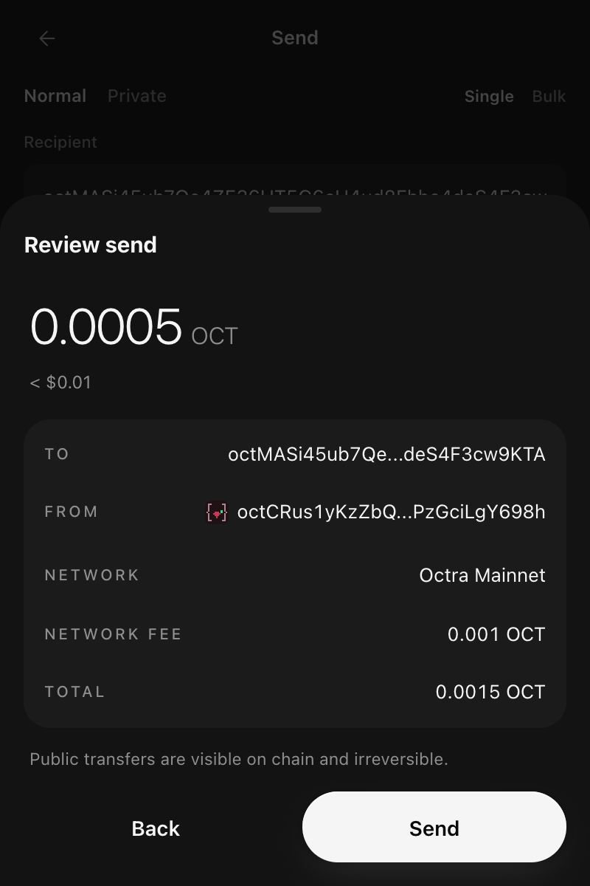

0xio lets you send native OCT, Octra tokens and private stealth transfers. To send a token instead of OCT, pick it on the Send screen; the steps below otherwise apply to both. Sending ETH and tokens on EVM networks is covered in [EVM Networks](/wallet/evm#sending).

Every send ends on a review before anything is signed. In the extension the review has **Back** and **Send**; the mobile app confirms with a slide.

<Frame caption="The send review in the extension">
  
</Frame>

## Standard Public Send

Send a transparent transaction visible on the blockchain.

<Steps>
  <Step title="Open Send Tab">
    Click "Send" in the main navigation
  </Step>
  <Step title="Enter Recipient">
    Enter the recipient's Octra address (starts with `oct`)

    - 47 characters (`oct` + 44 Base58)
    - Validates automatically
    - Can paste or scan QR code. On mobile, scanning a payment request (`octra:<address>?amount=<OCT>`) also fills the amount; see [Payment Requests](/wallet/receiving#payment-requests-mobile)
  </Step>
  <Step title="Enter Amount">
    Specify the amount to send

    - Enter in OCT units
    - Shows fiat equivalent (if available)
    - Displays available balance
  </Step>
  <Step title="Select Source">
    Choose **"Public Balance"** as the source
  </Step>
  <Step title="Review Transaction">
    Review the transaction details:

    - Recipient address
    - Amount to send
    - Network fee (see below)
    - Total including fees
  </Step>
  <Step title="Confirm and Sign">
    Tap **Send** on the review to sign. In the extension a result screen then shows **Sending**, and **Sent** once the network confirms it
  </Step>
</Steps>

### Transaction Details

- **Speed:** Typically a few seconds, subject to network conditions
- **Privacy:** Transaction is visible on the blockchain
- **Network fee:** Quoted live from the node via `octra_recommendedFee` and shown before you confirm

<Info>
Fees are denominated in **operational units (ou)** and displayed converted to OCT (1 OCT = 1,000,000 ou). The wallet reads its estimates from the node; you can pick another tier or set a custom ou value. One fee drives everything for a send: the fee shown, **Max**, the balance checks and the signature. If the fee cannot be read, the extension shows **Network fee unavailable** and blocks Review instead of guessing. See [Network Fees](#network-fees).
</Info>

## Private Send

Send a stealth transfer where the amount stays confidential. The wallet derives a one-time stealth address for the recipient via ECDH (x25519), encrypts the amount with PVAC-HFHE, and attaches a zero-knowledge range proof, all generated locally on your device.

<Steps>
  <Step title="Open Send Tab">
    Navigate to Send in the main menu
  </Step>
  <Step title="Enter Recipient">
    Input the recipient's Octra address
  </Step>
  <Step title="Enter Amount">
    Specify the amount to send
  </Step>
  <Step title="Select Private Balance">
    Choose **"Private Balance"** as the source
  </Step>
  <Step title="Review Encrypted Details">
    Review transaction information:

    - Recipient (visible)
    - Amount (will be encrypted)
    - Network fee (higher than a plain transfer because of proof generation)
  </Step>
  <Step title="Confirm">
    Confirm on the review. Proofs run before sending and can take a few minutes; the result screen shows **Queued** while they run
  </Step>
</Steps>

### How Private Transfers Work

1. **Local Proof Generation:** Your device encrypts the amount (PVAC-HFHE) and builds a range proof. A full-screen progress overlay shows each step (verify → encrypt → range proof → submit).
2. **Stealth Output:** A one-time stealth output is derived from the recipient's view key via ECDH so the recipient, and only the recipient, can detect it.
3. **Broadcast:** The encrypted payload and proof are submitted to the network.
4. **Validation:** Validators verify the proof on encrypted data without learning the amount.
5. **Claim:** The recipient scans for incoming stealth outputs and claims them into their private balance.

### Transaction Details

- **Speed:** Slower than a public send because proofs are generated locally
- **Privacy:** Amount is encrypted; the sender's address may be visible, the recipient is shielded behind a stealth output
- **Network fee:** Quoted live from the node, and never below 5,000 ou (proof-bearing transactions cost more ou than a plain transfer)

<Warning>
Private transfers require the recipient to **claim** the stealth output before the funds appear in their private balance. See [Receiving Funds](/wallet/receiving) and [Privacy Operations](/wallet/privacy-operations).
</Warning>

## Bulk Send

Send to multiple recipients in one flow. Each recipient is submitted as its own transaction and tracked individually, so the batch reports per-recipient success and failure.

<Steps>
  <Step title="Open Bulk / Batch Mode">
    Switch the Send screen to bulk with the "Bulk" tab (extension and desktop). The mobile app has no bulk send.
  </Step>
  <Step title="Add Recipients">
    Add addresses with individual amounts.

    - **Extension:** add up to 5 recipients, each with its own address and amount; remove rows with the trash icon. Bulk always sends OCT, and every address and amount is checked.
    - **Desktop:** add rows individually or paste/import a CSV (`address,amount` per line). The panel beside the rows shows the total, the fee per send and in total and what is left, flags duplicate addresses, and warns when the total exceeds your available balance. The review lists every send in order with Reject and Send, and the progress shows in the same card.
  </Step>
  <Step title="Choose Balance Type">
    Select the Public balance as the source. Private (FHE) bulk sends are available only in [0xio Desktop](/products/desktop); the extension sends privately to one recipient at a time.
  </Step>
  <Step title="Review Total">
    Review the total amount (fees included), the per-recipient breakdown and the fee.
  </Step>
  <Step title="Confirm">
    Confirm and sign. The wallet processes each transfer and reports how many succeeded. In the extension a bulk send reads **Sent** only once every transfer confirms on chain.
  </Step>
</Steps>

### When to Use Bulk Send

- **Time Saving:** Queue many transfers from a single screen instead of one at a time
- **Ideal For:**
  - Payroll and salary payments
  - Airdrops and token distributions
  - Multi-party settlements
  - Team payments

<Note>
Bulk send submits a separate transaction per recipient, so total fees scale with the number of transfers; there is no per-batch discount.
</Note>

## Confirming a Send (Mobile)

On the mobile app every send ends on a review: amount, recipient (with "First time sending to this address" when new), memo, fee, network and total. Slide to send to confirm, or tap outside the review to back out. With **Ask before sending** on (Settings, Security), Face ID or your PIN follows the slide; there is no address that skips it.

While a send runs you can close its progress screen. It keeps going on the wallet and network it was made on, and its result arrives as a notice.

## Network Fees

Every Octra fee is the node's live quote for that operation (`octra_recommendedFee`). No wallet signs a fee it made up: when the quote cannot be read, the action waits with a retry.

### Fee Tiers

The node quotes a **minimum**, a **recommended** and sometimes a **fast** fee. The wallet offers them as presets, plus **Custom**:

- **Recommended** is the default for every send.
- **Fast** is optional. When the node gives no fast quote, only the Fast preset is hidden; the other presets and Custom stay.
- **Custom** takes a whole number of ou, at least the operation's floor (below) and the network's live minimum, and at most 10,000,000 ou.

Higher fees confirm faster. During congestion a higher ou value helps a transaction get processed sooner.

### Floors for Private Operations

Private operations carry proofs, so each has a floor. Every preset is raised to it, and a custom fee below it is refused.

| Operation | Lowest fee |
|-----------|-----------|
| Key switch (turning on or updating the private balance) | 5,000 ou |
| Encrypt | 5,000 ou |
| Decrypt | 5,000 ou |
| Private (stealth) send | 5,000 ou |
| Claim | 3,000 ou |

### Ceiling

Sends and private operations top out at **10,000,000 ou**. A custom fee above it is refused, and a node quote above it is not used. Contract deploys pay a fee set by the size of the code instead.

### The Fee You Review Is the Fee You Sign

Right before signing, the wallet reads the live fee again. The reviewed fee is signed as long as the network still takes it. When the network's minimum has moved above it, nothing is signed and you are asked to review again.

<Note>
**Running your own node:** the wallet takes the first of the node's `recommended`, `base_fee` and `minimum` that is a whole number from 1 to 10,000,000 ou, and only when the minimum is not above it. A node that quotes none of them shows that its fee is unavailable. A `fast` value is used only when it is at least the recommended fee.
</Note>

EVM networks quote their own fees; see [EVM Networks](/wallet/evm#sending).

## Transaction Hash

The wallet computes each transaction's hash on your device before it sends it, the same way the network computes it. That is the hash shown in the result and in History, and you can look it up on the explorer even when the node's reply is lost.

## What Happens After You Send

The node answers every submit, and the wallet acts on that answer. A transaction is never signed a second time on its own.

| Node answer | What the wallet does |
|-------------|----------------------|
| Accepted | Waits for the network to confirm it |
| Not accepted for now (busy or temporary) | Sends the **same signed bytes** again, up to 3 tries in all |
| Nonce already used | Asks you to review again; nothing is re-signed. The mobile app first checks whether the nonce went to this same transaction |
| Rejected | Stops with **The network rejected this transaction.** Nothing is spent |
| Too large | Stops with **This transaction is too large.** |
| No reply | Checks the network for the transaction before calling it failed |

<Note>
For developers and node operators: the codes sent again unchanged are `107`, `110`, `117` and `-32005`. Code `112` means the nonce is already used. Codes `100` to `105`, `108`, `109`, `111`, `113` to `116`, `118`, `-32600` and `-32602` are rejections, and HTTP `413` is too large.
</Note>

### Not Confirmed

Sometimes the result of a send cannot be read: the reply times out, arrives twice, or says the nonce is taken. The mobile app then looks the transaction up on chain, first by its hash, then by your address and nonce:

- **Found:** it counts as sent.
- **Another transaction took that nonce:** you are asked to review again.
- **Neither:** the send stays pending and reads **Not confirmed**, with **Could not check whether this went through. Check History before sending again.** There is no Try again.

In the extension such a send stays on **Sending** until History settles it.

<Warning>
When a send shows **Not confirmed** or stays on **Sending**, open **History** before you send the same payment again. It may already be on its way, and a second send would pay twice.
</Warning>

## Transaction States

### Pending

- Transaction submitted to the network
- Awaiting validator confirmation, usually a few seconds
- A transaction that may have reached the node stays on **Sending** (or **Not confirmed** on mobile), and History settles it. Only a rejection from the node returns you to the form

### Confirmed

- Transaction included in block
- Funds transferred successfully
- Transaction hash available for explorer

### Failed

- Transaction rejected by the node, dropped or expired
- Nothing is spent when the node rejects a transaction; the extension shows the node's reason
- **Common causes:**
  - Insufficient balance for gas
  - Network connectivity issue
  - Invalid recipient address

## Adding a Memo

Include a message with your transaction:

1. Open the memo field on the Send screen
2. Enter memo text (up to 200 bytes in the extension; the length is counted in bytes, so some characters count as more than one)
3. **Note:** The memo is stored on-chain and visible to everyone. Memos go with public OCT sends; token sends carry none

**Use Cases:**
- Payment references
- Invoice numbers
- Personal notes

<Warning>
Memos are permanent and cannot be edited after the transaction is confirmed.
</Warning>

## Best Practices

### Security

- Always double-check recipient addresses
- Send a small test transaction first for large amounts
- Verify addresses through multiple channels
- Be cautious of phishing attempts

### Privacy

- Use **Private Balance** for sensitive transactions
- Encrypt funds before private transfers
- Monitor pending claims for incoming private transfers

### Efficiency

- Use **Bulk Send** for multiple recipients
- Consider standard priority unless urgent
- Group similar transactions to save on fees
